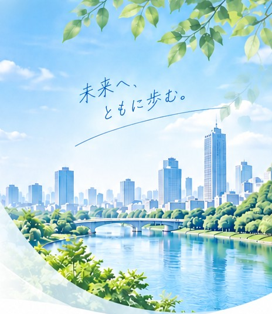

[index.html](https://github.com/user-attachments/files/33317864/index.html)
<!doctype html>
<html lang="ja">
<head>
<meta charset="utf-8">
<meta name="viewport" content="width=device-width, initial-scale=1">
<title>CAN-MIRAI｜がん対策、はじめの一歩をサポート。</title>
<meta name="description" content="CAN-MIRAI（愛媛県）は、がんについて知り、考えるきっかけをつくり、一人ひとりが自分らしく前を向いて歩めるようつなぐお手伝いをする団体です。">
<link rel="icon" href="images/logo.png">
<link rel="preconnect" href="https://fonts.googleapis.com">
<link rel="stylesheet" href="https://fonts.googleapis.com/css2?family=Zen+Maru+Gothic:wght@500;700&amp;family=Zen+Kaku+Gothic+New:wght@400;500;700&amp;family=Klee+One:wght@600&amp;display=swap">

</head>
<body>

<!-- ヘッダー -->
<header style="position: sticky; top: 0; z-index: 10; background: rgba(255,255,255,0.94); backdrop-filter: blur(8px); border-bottom: 1px solid #E3EEF7">

<a href="#top" style="display: flex; align-items: center; gap: 10px; text-decoration: none">

CAN-MIRAI
</a>
<nav aria-label="メインメニュー" style="display: flex; flex-wrap: wrap; align-items: center; gap: 4px 28px; font-size: 15px; font-weight: 500">
<a href="#top" style="text-decoration: none; color: #17509E; padding: 10px 2px; border-bottom: 2px solid #17509E">ホーム</a>
<a href="#about" style="text-decoration: none; color: #2E4257; padding: 10px 2px">団体について</a>
<a href="#activity" style="text-decoration: none; color: #2E4257; padding: 10px 2px">活動内容</a>
<a href="#news" style="text-decoration: none; color: #2E4257; padding: 10px 2px">お知らせ</a>
<a href="#contact" style="text-decoration: none; display: inline-flex; align-items: center; gap: 8px; background: #17509E; color: #FFFFFF; padding: 12px 26px; border-radius: 999px; font-weight: 700">
<svg width="18" height="18" viewBox="0 0 24 24" fill="none" stroke="currentColor" stroke-width="2" stroke-linecap="round" stroke-linejoin="round" aria-hidden="true"><rect x="3" y="5" width="18" height="14" rx="2"></rect><path d="M3 7l9 6 9-6"></path></svg>
お問い合わせ</a>
</nav>

</header>

<!-- ヒーロー -->
<section id="top" style="background: #F4F9FD">

CAN-MIRAI

<h1 style="margin: 8px 0 0; font-family: 'Zen Maru Gothic', sans-serif; font-weight: 700; font-size: 40px; line-height: 1.5; letter-spacing: 0.08em; color: #17509E">がん対策、 はじめの一歩をサポート。</h1>

がんについて知り、考えるきっかけをつくり、一人ひとりが自分らしく前を向いて歩めるようつなぐお手伝いをする団体です。

<a href="#about" style="text-decoration: none; background: #17509E; color: #FFFFFF; padding: 14px 32px; border-radius: 999px; font-weight: 700">団体について</a>
<a href="#contact" style="text-decoration: none; background: #FFFFFF; color: #17509E; border: 1.5px solid #17509E; padding: 13px 30px; border-radius: 999px; font-weight: 700">お問い合わせ</a>

</section>

<!-- 私たちの想い -->
<section id="about" style="padding: 88px 24px">

<h2 style="margin: 0; font-family: 'Zen Maru Gothic', sans-serif; font-weight: 700; font-size: 32px; letter-spacing: 0.2em; color: #17509E">私たちの想い</h2>

<svg width="44" height="44" viewBox="0 0 24 24" fill="none" stroke="currentColor" stroke-width="1.6" stroke-linecap="round" stroke-linejoin="round" aria-hidden="true"><path d="M9 18h6M10 21h4"></path><path d="M12 3a6 6 0 0 0-3.5 10.9c.6.5 1 1.2 1 2.1h5c0-.9.4-1.6 1-2.1A6 6 0 0 0 12 3z"></path></svg>

<h3 style="margin: 0; font-family: 'Zen Maru Gothic', sans-serif; font-weight: 700; font-size: 26px; letter-spacing: 0.2em; color: #17509E">知る</h3>

がんについて正しい情報を知るきっかけをつくります。

<svg width="44" height="44" viewBox="0 0 24 24" fill="none" stroke="currentColor" stroke-width="1.6" stroke-linecap="round" stroke-linejoin="round" aria-hidden="true"><circle cx="9" cy="8" r="3"></circle><circle cx="16.5" cy="9" r="2.5"></circle><path d="M3.5 20v-1.5A5.5 5.5 0 0 1 9 13a5.5 5.5 0 0 1 5.5 5.5V20"></path><path d="M15 13.6a4.5 4.5 0 0 1 6 4.2V20"></path></svg>

<h3 style="margin: 0; font-family: 'Zen Maru Gothic', sans-serif; font-weight: 700; font-size: 26px; letter-spacing: 0.2em; color: #17509E">考える</h3>

自分や大切な人のこれからについて考える機会を提供します。

<svg width="44" height="44" viewBox="0 0 24 24" fill="none" stroke="currentColor" stroke-width="1.6" stroke-linecap="round" stroke-linejoin="round" aria-hidden="true"><path d="M2 11l4-4 4 2 3-2 4 1 5 4"></path><path d="M2 11l3 3"></path><path d="M22 12l-6 6-1.5-1.5"></path><path d="M10 9l-2.5 3a1.4 1.4 0 0 0 2 2L12 12l5 5"></path><path d="M11 18l-1.5-1.5M13 16.5L11.5 15"></path></svg>

<h3 style="margin: 0; font-family: 'Zen Maru Gothic', sans-serif; font-weight: 700; font-size: 26px; letter-spacing: 0.2em; color: #17509E">つなぐ</h3>

必要に応じて専門機関や地域の支援とつなぎます。

</section>

<!-- メッセージ -->
<section style="padding: 0 24px 88px">

<h2 style="margin: 0; font-family: 'Zen Maru Gothic', sans-serif; font-weight: 700; font-size: 26px; line-height: 1.7; letter-spacing: 0.06em; color: #17509E">一人ひとりの「これから」に寄り添い、がんとともに生きる未来を支える社会を目指して。</h2>

CAN-MIRAIは、がんに関する正しい情報の普及や理解を深める取り組みを通して、一人ひとりが自分らしく前を向いて歩める社会の実現を目指しています。がんとともに生きる方、そのご家族、そしてこれからの世代のために、できることから、一歩ずつ取り組んでいきます。

</section>

<!-- 活動内容 -->
<section id="activity" style="padding: 88px 24px; background: #F4F9FD">

<h2 style="margin: 0; font-family: 'Zen Maru Gothic', sans-serif; font-weight: 700; font-size: 32px; letter-spacing: 0.2em; color: #17509E">活動内容</h2>

ACTIVITY 01

<h3 style="margin: 0; font-family: 'Zen Maru Gothic', sans-serif; font-weight: 700; font-size: clamp(16px, 4.4vw, 21px); letter-spacing: 0; color: #17509E">企業のがん対策推進サポート</h3>

企業や職場で、がん対策に取り組むためのお手伝いをします。がん検診の受診促進、社員さん向けの研修・セミナー、治療と仕事の両立支援の体制づくりなど、職場に合わせた取り組みをご提案します。

ACTIVITY 02

<h3 style="margin: 0; font-family: 'Zen Maru Gothic', sans-serif; font-weight: 700; font-size: clamp(16px, 4.4vw, 21px); letter-spacing: 0; color: #17509E">がんと経済的な備えのセミナー</h3>

がんになったときにかかるお金や、公的制度で足りない部分について学ぶ機会をつくります。自分や家族に合った備え方を一緒に考えます。

ACTIVITY 03

<h3 style="margin: 0; font-family: 'Zen Maru Gothic', sans-serif; font-weight: 700; font-size: clamp(16px, 4.4vw, 21px); letter-spacing: 0; color: #17509E">個別相談・ライフプラン相談</h3>

お一人おひとりの状況にあわせて、これからの暮らしやお金の備えについてご相談をお受けします。

</section>

<!-- お知らせ -->
<section id="news" style="padding: 88px 24px">

<h2 style="margin: 0; font-family: 'Zen Maru Gothic', sans-serif; font-weight: 700; font-size: 32px; letter-spacing: 0.2em; color: #17509E">お知らせ</h2>

<ul style="list-style: none; margin: 0; padding: 0; width: 100%; border-top: 1px solid #DCE7F1">
<li style="display: flex; flex-wrap: wrap; gap: 4px 32px; padding: 22px 8px; border-bottom: 1px solid #DCE7F1">
<time datetime="2026-09-01" style="font-weight: 700; color: #17509E; flex: 0 0 120px">2026.09.01</time>
CAN-MIRAIを設立しました。
</li></ul>

</section>

<!-- 団体概要 -->
<section style="padding: 0 24px 88px">

<h2 style="margin: 0; font-family: 'Zen Maru Gothic', sans-serif; font-weight: 700; font-size: 28px; letter-spacing: 0.2em; color: #17509E">団体概要</h2>

<svg width="40" height="40" viewBox="0 0 24 24" fill="none" stroke="#2F7BC0" stroke-width="1.8" stroke-linecap="round" stroke-linejoin="round" aria-hidden="true"><path d="M12 21s-7-6.2-7-11.5A7 7 0 0 1 19 9.5C19 14.8 12 21 12 21z"></path><circle cx="12" cy="9.5" r="2.5"></circle></svg>

所在地愛媛県

<svg width="40" height="40" viewBox="0 0 24 24" fill="none" stroke="#2F7BC0" stroke-width="1.8" stroke-linecap="round" stroke-linejoin="round" aria-hidden="true"><rect x="3" y="5" width="18" height="16" rx="2"></rect><path d="M3 10h18M8 3v4M16 3v4"></path></svg>

設立日2026年9月1日

</section>

<!-- お問い合わせ -->
<section id="contact" style="padding: 80px 24px; background: linear-gradient(180deg, #17509E, #123F7D); color: #FFFFFF">

未来へ、ともに歩む。

<h2 style="margin: 0; font-family: 'Zen Maru Gothic', sans-serif; font-weight: 700; font-size: 32px; letter-spacing: 0.15em">お問い合わせ</h2>

企業でのがん対策の取り組み、講演・セミナーのご依頼など、お気軽にご相談ください。

<a href="mailto:canmirai.info@gmail.com" style="text-decoration: none; display: inline-flex; align-items: center; gap: 10px; background: #FFFFFF; color: #17509E; padding: 16px 40px; border-radius: 999px; font-weight: 700; font-size: 17px; margin-top: 8px">
<svg width="20" height="20" viewBox="0 0 24 24" fill="none" stroke="currentColor" stroke-width="2" stroke-linecap="round" stroke-linejoin="round" aria-hidden="true"><rect x="3" y="5" width="18" height="14" rx="2"></rect><path d="M3 7l9 6 9-6"></path></svg>
メールで問い合わせる</a>

canmirai.info@gmail.com

</section>

<footer style="background: #0E3266; color: #BFD6EC; padding: 28px 24px; font-size: 13px">

CAN-MIRAI
© 2026 CAN-MIRAI

</footer>

</body>
</html>
